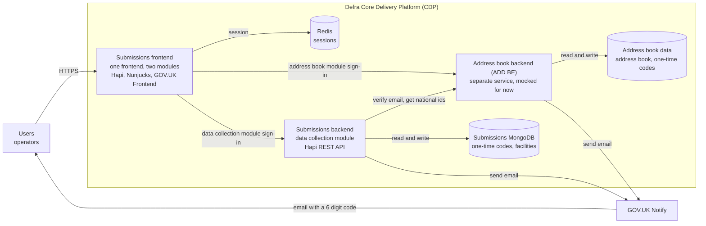
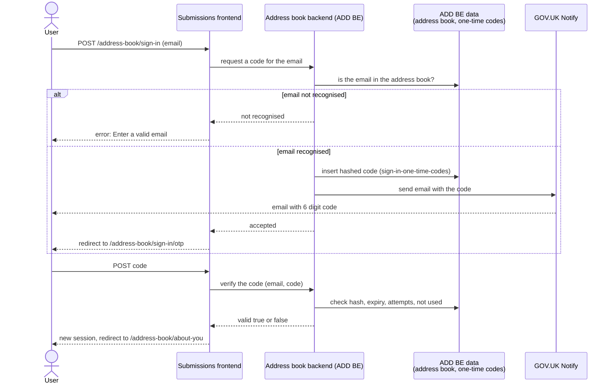
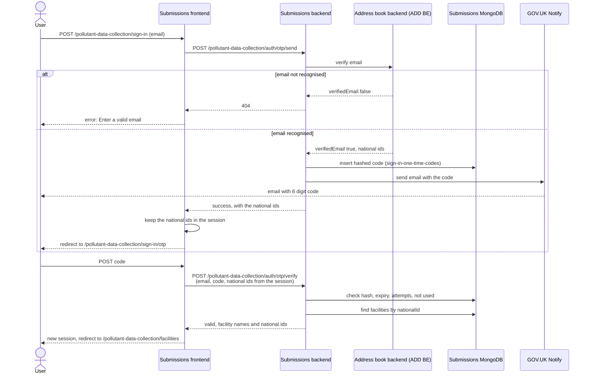
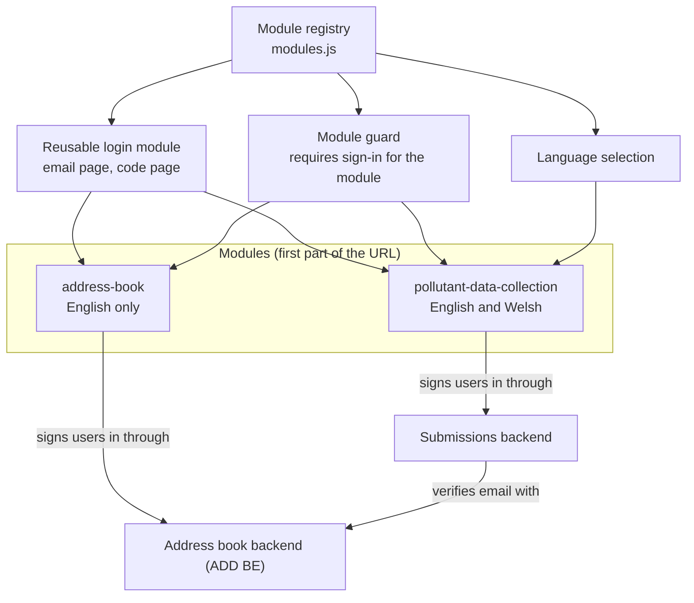
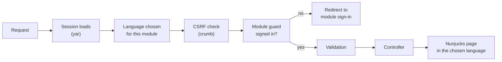
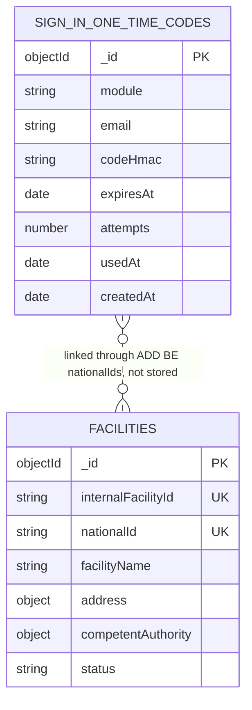
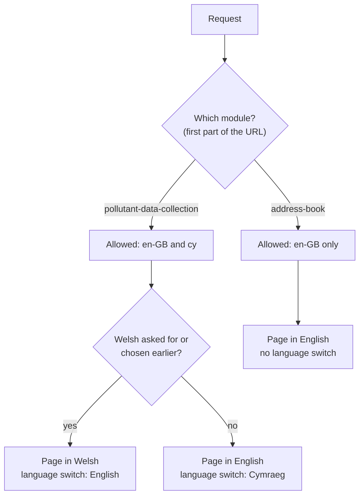

# PRTR digital service: architecture overview

Prepared for stakeholders. First written 2 November 2026. Updated 13 November 2026: one frontend serves two modules, and each module signs users in through its own backend service.

Services:

- `aqie-prtr-submissions-frontend`: the one web application. It serves both modules.
- `aqie-prtr-submissions-backend`: API and database for the **PRTR data collection** module.
- **Address book backend service (ADD BE)**: a separate service, not in these two repositories. It holds the address book and signs in users of the **address book** module.

Diagrams in this document are written in Mermaid. They render in GitHub, in VS Code (Markdown preview with a Mermaid extension) and in most documentation tools.

---

## 1. Summary

The Pollutant Release and Transfer Register (PRTR) service lets two groups of users report data through a GOV.UK-styled website:

| Module | URL prefix | Users | Purpose | Welsh |
|---|---|---|---|---|
| **Authentication** | inside each module | all users | One reusable sign-in (email, then a one-time code) used by every module. The pages are shared, the backend behind them depends on the module | Follows the module it sits in |
| **PRTR address book** | `/address-book` | operators / facilities | Collect contact details of the facilities and operators who will report | No |
| **PRTR data collection** | `/pollutant-data-collection` | operators | Collect pollutant and waste data (built mostly with Defra forms) | **Yes** |

The two modules sign users in through **different backends**:

| Module | Sign-in is handled by | Who checks the email | Who creates, stores and emails the code | Result after the code is verified |
|---|---|---|---|---|
| Address book | **ADD BE**, called directly by the frontend | ADD BE (its own address book) | ADD BE (its own `sign-in-one-time-codes`) | Signed in |
| Data collection | **Submissions backend**, called by the frontend | ADD BE, called by the submissions backend | Submissions backend (its own `sign-in-one-time-codes`) | Signed in, plus the facility name and national ID of each linked facility |

Key points:

- **One frontend, one login screen design, two backends.** The sign-in pages are built once and placed inside each module. The module decides which backend they talk to.
- **Modules are separated by URL.** The first part of the URL (`/address-book/...`) identifies the module. It decides the sign-in text, the backend, the landing page and the language rules.
- **Only the data collection module is in Welsh.** The address book is internal facing and stays in English.
- **Built on Defra's Core Delivery Platform (CDP)** with the standard Defra Node.js stack, GOV.UK Frontend, MongoDB, Redis and GOV.UK Notify.
- **Defra forms** (the Defra forms engine) will provide the data collection forms for modules 2 and 3.

### Current status

| Area | Status |
|---|---|
| Starter Home and About pages | **Removed** |
| Authentication module (email page, code page) | **Planned**, design in section 6 |
| Address book module sign-in (frontend to ADD BE) | **Planned**. ADD BE does not exist yet, so this path cannot run end to end until it does (section 6.4) |
| Data collection module sign-in (submissions backend) | **Planned**. The call from the submissions backend to ADD BE uses a **mock** with the agreed response shape (section 6.4) |
| One-time codes and facilities collections (submissions backend) | **Planned**, design in section 8. The facilities collection gets **dummy records** until real data is loaded |
| Per-module session, guard and landing pages | **Planned** |
| Language rules per module, Welsh text | **Planned** (see section 9) |
| Defra forms for modules 2 and 3 | **Planned** (a working reference exists in `aqie-prtr-frontend`) |
| Production hardening (rate limiting, secrets, proxy for Notify) | **Planned** |

---

## 2. System overview



Three services, with the frontend shared by both modules:

- The **submissions frontend** serves the pages of both modules and holds the user's session. For the address book module it calls ADD BE directly. For the data collection module it calls the submissions backend.
- The **submissions backend** serves the data collection module. It owns that module's one-time codes and the facilities, and sends its own emails. It asks ADD BE whether an email is known and which facilities (national IDs) the user is linked to.
- The **address book backend (ADD BE)** owns the address book. It signs in users of the address book module itself, with its own one-time codes and emails, and answers the submissions backend's email checks.

The browser never talks to either backend and never sees a code. Section 6 shows both sign-in flows as separate diagrams.

---

## 3. Hosting and infrastructure (CDP)

The service runs on Defra's **Core Delivery Platform (CDP)**.

| Topic | How it is used |
|---|---|
| Packaging | Each service is a Docker container (multi-stage `Dockerfile`: development and production images) |
| Environments | `infra-dev`, `management`, `dev`, `test`, `perf-test`, `ext-test`, `prod` (the list the services are configured for) |
| Data services | MongoDB for data, Redis for sessions (Redis keys are namespaced by service name) |
| Outbound traffic | Through the platform proxy (configured by environment variables), including calls to GOV.UK Notify |
| Configuration and secrets | Environment variables validated at start-up (`convict`). Secrets such as the Notify API key and cookie password come from CDP, never from the code |
| Logging and tracing | Structured JSON logs (ECS format, `pino`), request tracing header `x-cdp-request-id`, platform audit and metrics libraries (`@defra/cdp-auditing`, `@defra/cdp-metrics`) |
| Health | `GET /health` used by the platform to check the service |
| Build and delivery | GitHub Actions workflows (`check-pull-request`, `publish`, `publish-hotfix`), SonarCloud quality checks, Dependabot template |
| Local development | Docker Compose with MongoDB 7.0, Redis 7.2 and Floci (a local AWS emulator), so developers can run everything on a laptop |

---

## 4. Technology stack

### 4.1 Frontend (`aqie-prtr-submissions-frontend`)

| Area | Technology | Version |
|---|---|---|
| Runtime | Node.js | 24 or later |
| Web framework | Hapi (`@hapi/hapi`) | 21.4 |
| Template engine | Nunjucks with `@hapi/vision` | 3.2 |
| UI framework | GOV.UK Frontend (GOV.UK Design System) | 6.6 |
| Styling and build | Sass and Vite | Vite 8 |
| Validation | Joi | 18 |
| Authentication | Email one-time code, checked by the backend that belongs to the module (see section 6) | n/a |
| Session management | `@hapi/yar` (session), Redis via `@hapi/catbox-redis` and `ioredis` (in-memory cache for local development) | yar 11 |
| CSRF protection | `@hapi/crumb` | 9 |
| Security headers | `blankie` (Content Security Policy), HSTS, `@hapi/scooter` | n/a |
| Configuration | `convict` | 6.2 |
| Logging | `pino`, `hapi-pino`, ECS format | pino 10 |
| Language support (i18n) | In-house module (`helpers/i18n.js`), no third-party library; see section 9 | n/a |
| Forms (planned) | Defra forms engine (`@defra/forms-engine-plugin`) | 5.0.0-alpha.25 |
| Testing | Vitest with coverage (v8), `cheerio`, `vitest-fetch-mock` | Vitest 4 |
| Code quality | ESLint (neostandard), Prettier, Stylelint, Husky pre-commit hooks, SonarCloud | ESLint 9 |

### 4.2 Backend (`aqie-prtr-submissions-backend`)

| Area | Technology | Version |
|---|---|---|
| Runtime | Node.js | 24 or later |
| Web framework | Hapi (`@hapi/hapi`) with `@hapi/boom` for errors | 21.4 |
| Database | MongoDB (official `mongodb` driver) | driver 7.7, server 7.0 |
| Validation | Joi | 18 |
| Email | GOV.UK Notify (`notifications-node-client`) | 8.2 |
| Authentication | One-time code, hashed with HMAC-SHA256 (Node `crypto`) | n/a |
| Locks | `mongo-locks` | 3.2 |
| Configuration | `convict` | 6.2 |
| Logging | `pino`, `hapi-pino` | pino 10 |
| Testing | Vitest with coverage, `vitest-mongodb` (in-memory MongoDB), `vitest-fetch-mock` | Vitest 4 |
| Code quality | ESLint (neostandard), Prettier, Husky, SonarCloud | n/a |

The address book check goes through one small client in the submissions backend, so the mock can be replaced by the real HTTP call without touching the sign-in code. ADD BE has its own repository and stack and is not described in this table.

---

## 5. Key architectural decisions

| # | Decision | Why |
|---|---|---|
| D1 | One **server-rendered frontend** shared by both modules, and **separate REST backend services** | Follows the CDP pattern. Keeps data, secrets and email sending away from the browser. Pages work without client-side JavaScript, as the GOV.UK service standard expects |
| D2 | **GOV.UK Frontend / Design System** for all pages | Accessible, consistent, familiar to users |
| D3 | The **module is the first URL segment** (`/address-book`, `/pollutant-data-collection`), looked up in one **module registry** | One simple rule drives sign-in text, landing page and language. Adding a module is a registry entry |
| D4 | **One reusable login module in the frontend**, registered once per module | No duplicate sign-in pages. Each module only changes the text, the landing page and **which backend it calls** |
| D5 | **Separate sign-in per module** | Users must sign in to each module. Public and admin users never share a login |
| D6 | **Each module signs users in through its own backend.** The address book module uses ADD BE directly. The data collection module uses the submissions backend | The address book backend already holds the address book. The data collection module has its own data (facilities) and its own backend |
| D7 | **The backend that signs a user in creates, stores and emails the code.** The frontend only stores "signed in to module X" and, for data collection, the facilities it was given | Codes never reach the browser. Each backend enforces the security rules for its own codes |
| D8 | **GOV.UK Notify is called directly by each backend that sends codes** (ADD BE and the submissions backend) | Simple and secure. No extra service needed for this flow |
| D9 | **Language rules per module** (English `en-GB` and Welsh `cy`) | Only the public facing module needs Welsh. Admin modules stay English |
| D10 | **Defra forms engine** for data collection forms (modules 2 and 3) | Defra's standard way to build accessible, multi-page forms from a definition file, with built-in Welsh support |
| D11 | **An unrecognised email gets a clear error** ("Enter a valid email"), as the acceptance criteria require | Better for users. It lets someone discover which emails are known, so it needs rate limiting and is listed as an open question (section 14) |
| D12 | Configuration from **validated environment variables**; secrets from CDP | Safe, consistent across environments |
| D13 | **For the data collection module, the submissions backend verifies the email with ADD BE before any code is created or sent** | No code is stored or emailed for an unknown address. ADD BE stays the single source of truth for who is known |
| D14 | **Facilities are stored in the submissions backend** and linked to a user through the `nationalId` values ADD BE returns | The facility name and national ID are returned with the sign-in result without a second round trip from the browser. The address book module does not need facilities |

---

## 6. The reusable authentication module

### 6.1 User journey

1. The user opens a module URL, for example `/address-book`.
2. If not signed in, they are redirected to that module's sign-in page: `/address-book/sign-in`.
3. They enter their email address and select **Continue**. Which backend handles it depends on the module (sections 6.2 and 6.3).
   - **Recognised:** a **6-digit code** is created and emailed with GOV.UK Notify. The user goes to the "Check your email for a code" page.
   - **Missing, badly formed or not recognised:** the page stays and shows an error (table below).
4. They enter the code on `/address-book/sign-in/otp` (or the same path under the other module).
5. On success the frontend stores "signed in to this module" in the session (4 hours) and sends the user to the module's first page.
   - **Address book module:** nothing else is returned.
   - **Data collection module:** the backend also returns the **facility name and national ID** of each facility linked to the user. The frontend keeps them in the session.
6. Sign out is **planned** and is not part of the first build.

| Module | Landing page after sign-in |
|---|---|
| PRTR address book | `/address-book/about-you` |
| PRTR data collection | `/pollutant-data-collection/facilities` |

The bare module URL is also handled: signed out it goes to sign-in, signed in it goes to the landing page.

#### Email page errors

| Situation | Message shown |
|---|---|
| Nothing entered | Enter an email address |
| Not in an email format | Enter a valid format |
| Well formed, but the address book does not recognise it | Enter a valid email |
| The code email could not be sent | We could not send a code. Try again. |

The page also has a "My email address is not recognised" help section. Its text is "Contact XXX to let them know there is a problem with you accessing the service". **XXX is a placeholder** until the contact is confirmed.

### 6.2 Address book module: sign-in flow

The frontend calls ADD BE directly. The submissions backend is **not involved**.



### 6.3 Data collection module: sign-in flow

The frontend calls the submissions backend. The submissions backend checks the email with ADD BE, then creates and sends the code itself.



ADD BE is called **once**, when the code is requested. Its answer (the national IDs) is kept in the frontend session. After the code is verified the submissions backend uses those IDs to read its own `facilities` collection and does not call ADD BE again.

The national IDs stay on the server side of the frontend (never shown in the page) and the user only sees the facility names after a correct code.

### 6.4 The ADD BE interfaces

ADD BE does not exist yet. There are two different interfaces to it.

**A. Email check, used by the submissions backend (data collection module).** The submissions backend calls ADD BE through one small client, which is **mocked** for now with the agreed response shape. Swapping in the real HTTP call changes that one file.

```json
{
  "verifiedEmail": true,
  "isNationalRegulator": false,
  "associatedNationalIds": [
    { "nationalId": "EPR/AB1234CD", "name": "Riverside Chemical Works" }
  ]
}
```

| Field | Meaning |
|---|---|
| `verifiedEmail` | `true` if the address book knows this email. `false` stops the sign-in before any code is created |
| `isNationalRegulator` | `true` for national regulator users. Part of the agreed response, but neither module uses it yet |
| `associatedNationalIds` | The facilities this user is linked to. Each `nationalId` matches the `nationalId` of a record in the submissions backend's `facilities` collection |

The mock treats an email that starts with `unknown` as not recognised, an email containing `regulator` as a national regulator, and everything else as recognised and linked to two sample facilities.

**Size limit.** A user is linked to **about 30 national IDs at most**, not hundreds. The IDs are kept in the session and sent back on the verify call, so the list is kept short. The submissions backend refuses a verify request with more than 30 IDs. What ADD BE does for a user with more than 30 is not decided (section 14).

**B. Sign-in, used directly by the frontend (address book module).** ADD BE needs two operations: request a code for an email, and verify a code. The paths, the responses and the authentication between the frontend and ADD BE are **not yet agreed** (section 14). The proposal is to give ADD BE the same two operations and response shapes as the submissions backend (`/auth/otp/send` and `/auth/otp/verify`), so the one login module in the frontend can talk to either backend.

Until ADD BE exists, the address book module sign-in cannot run end to end.

### 6.5 Security measures

These apply to each backend that creates codes: ADD BE for the address book module and the submissions backend for the data collection module.

| Measure | Detail |
|---|---|
| Code generation | Cryptographically random 6-digit code |
| Code storage | Only an HMAC-SHA256 hash (`codeHmac`) is stored. The code is never stored or logged in clear text |
| Expiry and single use | Valid for **15 minutes** (`expiresAt`). A used code is marked with `usedAt` and cannot be used again. Records are removed 24 hours after creation |
| Attempt limit | 5 wrong attempts lock the code (counted atomically, so parallel guesses cannot get around it) |
| Resend cooldown | 60 seconds between emails to the same address. **Planned**, not in the first build |
| Email enumeration | The acceptance criteria show an error for an unrecognised email, so someone could discover which emails are known. Rate limiting per address and per IP is **planned** before production (section 14) |
| Module isolation | A code for one module cannot be used in another. Each module has its own backend, so this holds by design. If several modules ever share one backend, the `module` field in section 8 is needed |
| New session on sign-in | A fresh session id is issued after sign-in (prevents session fixation) |
| CSRF protection | All form posts need a token (`@hapi/crumb`) |
| Service-to-service calls | Calls to ADD BE need authentication between the services. Not yet agreed (section 14) |
| Transport and headers | HTTPS, secure cookies in production, HSTS, Content Security Policy |

### 6.6 Session management

- The session is created with `@hapi/yar` and stored with a cookie (4 hour lifetime). Redis is used for server-side caching in CDP environments, and an in-memory cache locally.
- Sign-in state is kept **per module**:
  - `address-book`: `{ email, authenticated }`
  - `pollutant-data-collection`: `{ email, authenticated, nationalIds, facilities: [{ facilityName, nationalId }] }`. `nationalIds` is saved when the code is requested and used to look up the facilities once the code is verified. `facilities` is filled after verification.
- Signing in to one module never signs the user in to another, and a user can be signed in to both at once.
- The `facilities` list is a copy taken at sign-in. It is not refreshed until the user signs in again. Both `nationalIds` and `facilities` hold about 30 entries at most (section 6.4), which keeps the session small.
- Sign-out is planned. It will remove only the current module's entry.

---

## 7. How modules are separated

### 7.1 The module registry

```text
Frontend  src/config/modules.js       URL prefix -> languages, landing page, which backend signs users in
Backend   src/common/auth-modules.js   (submissions backend only) modules it signs in -> Notify template
```

The frontend registry is the single place that says which backend a module uses.

```js
// frontend: src/config/modules.js (sketch)
'address-book': {
  languages: ['en-GB'],
  startPath: '/address-book/about-you',
  authBackend: 'address-book-backend'        // frontend calls ADD BE directly
},
'pollutant-data-collection': {
  languages: ['en-GB', 'cy'],
  startPath: '/pollutant-data-collection/facilities',
  authBackend: 'submissions-backend'         // submissions backend calls ADD BE
}
```

Adding a module means adding one entry to the frontend registry, and one to the submissions backend registry only if that backend signs the module's users in. The sign-in pages, routes, guard and language rules pick it up automatically.

#### Adding a new module later

1. Choose a URL prefix. It must not clash with shared paths (`cookies`, `health`, `public`) or with the reserved page names `sign-in` and `sign-out`.
2. Add the module to the frontend registry: prefix, allowed languages, landing page and **the backend that signs its users in**.
3. If that backend is the submissions backend, add the module to its registry so `/{module}/auth/otp/send` and `/verify` exist for it. If it is ADD BE or another service, that service must offer the same two sign-in operations (section 6.4).
4. Add the landing page and its `content.js` (with a `cy` block only if the module supports Welsh).
5. If the module uses the submissions backend and needs the address book check, confirm with the address book team how ADD BE tells the module apart. The agreed response has no module information (section 14).

What changes with a new module is only the text, the landing page, the language rule and the backend choice. The email page, code page and session handling are reused as they are.



### 7.2 URL structure

| URL | Purpose |
|---|---|
| `/{module}` | Entry: goes to sign-in or to the landing page |
| `/{module}/sign-in` | Email page |
| `/{module}/sign-in/otp` | Code page |
| `/{module}/sign-out` | Sign out (POST). Planned |
| `/address-book/about-you` | Address book landing page |
| `/pollutant-data-collection/facilities` | Data collection landing page |
| `/cookies`, `/health` | Shared pages, outside any module |

### 7.3 Folder structure

```text
aqie-prtr-submissions-frontend/
  src/
    config/
      modules.js                      module registry (prefix, languages, landing page, auth backend)
      config.js                       validated configuration (convict)
      nunjucks/                       template engine setup and page context
    server/
      server.js                       creates the Hapi server and registers plugins
      plugins/
        language-selection.js         chooses English or Welsh per module
        module-auth.js                guard: redirects to sign-in when not signed in
        csrf.js, session-cache.js     CSRF and sessions
        content-security-policy.js    security headers
        router.js                     registers all routes
      routes/
        login/                        THE REUSABLE LOGIN MODULE
          index.js                    registers the sign-in routes for every module
          email/  otp/                controllers, templates and text of the two pages
          auth-service.js             calls the backend the module registry names (ADD BE or submissions backend)
          auth-session.js             per-module sign-in state
          sign-out-controller.js      sign-out
          entry-controller.js         bare module URL
        address-book/about-you/       module 2 landing page
        pollutant-data-collection/facilities/   module 3 landing page
        cookies/  health/             shared pages
      common/
        helpers/i18n.js               language support
        templates/layouts/page.njk    shared page layout
        components/                   shared UI components

aqie-prtr-submissions-backend/
  src/
    common/auth-modules.js            module registry (modules this backend signs in)
    routes/auth.js                    POST /{module}/auth/otp/send and /verify
    services/
      otp-service.js                  codes: verify email, create, hash, check, expire
      address-book-client.js          calls ADD BE (mocked for now)
      facilities-service.js           finds facilities by national id, dummy seed data
      notify-client.js                GOV.UK Notify
    plugins/mongodb.js                database connection and indexes

address book backend (ADD BE)         separate service and repository, not shown here
```

### 7.4 What happens to a request



Choosing the language early means that even error pages (such as a failed CSRF check) appear in the right language.

---

## 8. Data design (MongoDB)

Data is split between two services. Each service keeps its own data.

| Service | Collections | Used for |
|---|---|---|
| Address book backend (ADD BE) | The address book (users, facilities they are linked to) and its own `sign-in-one-time-codes` | Address book module sign-in, and answering email checks from the submissions backend. Not described further here |
| Submissions backend | `sign-in-one-time-codes` and `facilities` | Data collection module sign-in and the facility list |

The submissions backend has **no user collection**: it asks ADD BE whether an email is known. The two `sign-in-one-time-codes` collections have the same structure but are separate, one per backend.



### 8.1 `sign-in-one-time-codes` (submissions backend)

| Field | Type | Notes |
|---|---|---|
| `_id` | objectId | Primary key |
| `module` | string | **Optional, proposed** (not in the original design). Only needed if more than one module signs in through this backend, so a code cannot be used in another module. Today only the data collection module does. To confirm |
| `email` | string | Lower case |
| `codeHmac` | string | HMAC of the code. Never the code itself |
| `expiresAt` | date | `createdAt` + 15 minutes |
| `attempts` | number | Wrong guesses, maximum 5 |
| `usedAt` | date | Empty until used, then set. A code is used once |
| `createdAt` | date | Records are deleted 24 hours after this date (TTL index) |

Indexes: `email` + `createdAt` (descending) for finding the latest code, and a TTL index on `createdAt` of 24 hours.

### 8.2 `facilities` (submissions backend)

Stores the facilities that data collection users can be linked to. The sign-in flow reads only `nationalId` (the link to ADD BE) and returns the **facility name and national ID** of each match.

| Field | Type | Notes |
|---|---|---|
| `_id` | objectId | Primary key |
| `internalFacilityId` | string | Unique. `f-` plus 32 hex characters, never changes |
| `nationalId` | string | Unique. The national ID (was `facilityCode`). Matches `nationalId` from ADD BE |
| `historicalNationalIds` | string[] | IDs before a rename |
| `facilityName`, `address`, `location` | string, object, geojson | From the registry. `location` can be empty |
| `competentAuthority` | object | Who regulates it |
| `naceCode`, `mainEconomicActivityName` | string | NACE classification and name |
| `nutsRegionId`, `riverBasinDistrictCode` | string | Region and river basin district |
| `dataSource` | string | Where the record came from, for example `ricardo-tsv` or an admin import |
| `status` | string | The status kept up to date |
| `createdAt`, `createdBy`, `updatedAt`, `updatedBy` | date, string | Audit fields. The `By` fields hold an email or an import name |

The full design has more read-only fields copied from the Ricardo data (contact telephone, permits, latest reporting year and others). They are not used by the sign-in flow and are added when the facility data is loaded.

**Dummy data.** Until real data is loaded, a few dummy facilities are inserted when the backend starts in a local environment and the collection is empty. Two of them match the `nationalId` values returned by the ADD BE mock, so a sign-in returns real-looking results end to end.

Data collection records (pollutant data, address book entries) will be designed with the Defra forms work.

---

## 9. Welsh language support

### 9.1 Rules

| Module | Languages | Language switch |
|---|---|---|
| PRTR data collection | English (`en-GB`) and Welsh (`cy`) | Shown |
| PRTR address book | English only | Hidden |

- The language code for English is **`en-GB`** (not `en`). Welsh is **`cy`**. This matches the Defra forms engine.
- The language is chosen with `?language=cy` or `?language=en-GB`, remembered in the session, and defaults to English.
- English-only modules ignore a Welsh request, show no switch and keep `<html lang="en-GB">`, including on error pages.
- A user's Welsh choice is remembered when they pass through an English-only module and come back to the Welsh one.

### 9.2 How it works



### 9.3 i18n (language support) in this project

- Language support is provided by a small **in-house i18n module** (`src/server/common/helpers/i18n.js`). It has **no third-party i18n dependency**.
- Page text lives in a `content.js` file next to each page, with an `en-GB` block and a `cy` block side by side, so both languages are edited together.
- The module scans these files at start-up. Text is looked up by key (`t('login.email.default.title')`). If a Welsh string is missing, English is shown, never an error.
- The sign-in pages share text with a `default` set and per-module overrides, so only what differs is written for each module.
- The Defra forms engine has its **own translation mechanism** for form content (see section 10). The two work side by side and use the same language codes.

### 9.4 Welsh status

Only the shared error summary title has Welsh text so far. The sign-in pages and the data collection landing page need Welsh text, which **must be reviewed by a Welsh translator** before real use.

---

## 10. Defra forms

The data collection modules (address book and pollutant data) will be built mostly with the **Defra forms engine**, Defra's standard forms framework.

| Topic | Detail |
|---|---|
| Package | `@defra/forms-engine-plugin` |
| Version | **5.0.0-alpha.25**, the latest line at the time of writing |
| Why this version | It is the line that supports Welsh. The team's finding is that earlier versions do not, so the version is pinned |
| What it gives us | Multi-page forms described by JSON definition files, GOV.UK styled pages, validation, summary and "check your answers" pages, and plug-in points for custom pages |
| Forms definitions | JSON files (schema 2, engine V2) listing pages, questions and lists |
| Welsh | A `metadata.translations.cy` block in each definition holds the Welsh titles, hints and list items, keyed by the page and question ids |
| Language hook | The application supplies a `getLanguage` function so the engine uses the same language as the rest of the site |
| Custom pages | Custom page controllers for special pages (for example dynamic radio lists and summary pages) |
| Sign-in | The engine's `onRequest` hook redirects signed-out users to the module's sign-in page |
| Reference | A working example exists in `aqie-prtr-frontend` (two forms with Welsh) |

Status: **not yet added to `aqie-prtr-submissions-frontend`**. The landing pages are placeholders so the sign-in and navigation could be built first. Adding the forms is the next phase.

Points to resolve when adding forms:

- Forms are served at `/{form-slug}/...`, so a form's slug must sit under its module prefix (or be listed against the module in the registry).
- The pages `sign-in` and `sign-out` are reserved names and must not be used as form page paths.
- The engine's `getLanguage(query, yar)` hook has no access to the URL, so the effective language for the request will be saved in the session for the engine to read.

---

## 11. GOV.UK Notify (email)

| Topic | Detail |
|---|---|
| Purpose | Sends the one-time code by email |
| Caller | Each backend that sends codes calls Notify directly, using the official `notifications-node-client`: ADD BE for the address book module, the submissions backend for the data collection module |
| Template | The code is passed in a `((code))` placeholder. Whether the two backends share one template is not decided (section 14) |
| Configuration | API key and template id from environment variables (`GOVUK_NOTIFY_API_KEY`, `GOVUK_NOTIFY_AUTHENTICATION_TEMPLATE_ID`) in each backend. Secrets come from CDP |
| Key types | Test (no email sent), Team and guest list (real email to approved addresses, for development and test environments), Live (production) |
| Resilience | If Notify fails, the stored code is removed and the user sees "We could not send a code. Try again." |
| Not used | The separate `aqie-notify-service` is not used for this flow. A direct call is simpler for one email type |

---

## 12. Quality and testing

| Layer | Approach |
|---|---|
| Unit and integration tests | Vitest. The frontend tests drive the whole sign-in journey for each module, including errors. The backend tests use an in-memory MongoDB |
| Test coverage areas | Sign-in for each module, unrecognised email, wrong, expired and reused codes, attempt limits, facilities returned for a data collection user, CSRF, language rules per module. Notify and ADD BE are replaced by test doubles, so tests never send email |
| Static analysis | ESLint (neostandard), Stylelint for styles, Prettier for formatting |
| Pre-commit | Husky hooks run formatting, lint and tests |
| Pipeline | GitHub Actions on pull requests and publishing |
| Quality gate | SonarCloud |
| Accessibility | GOV.UK Design System components, error summaries, correct `lang` attributes |

---

## 13. Roadmap

| Phase | Content | Status |
|---|---|---|
| 0 | Remove the starter Home and About pages | Done |
| 1 | Submissions backend: ADD BE check (mocked), one-time codes, Notify, facilities with dummy data | Planned |
| 2 | Reusable login module in the frontend (email and code pages), per-module sessions and backends, landing pages | Planned |
| 2b | Address book module sign-in against ADD BE (frontend to ADD BE). Depends on ADD BE existing and on the interface in section 6.4 | Planned, blocked on ADD BE |
| 3 | Language rules per module, Welsh text for the Welsh module | Planned |
| 4 | Defra forms for address book and data collection | Planned |
| 5 | Hardening: rate limiting, secrets, proxy for Notify, accessibility review, monitoring | Planned |

## 14. Risks and open decisions

| Item | Notes |
|---|---|
| ADD BE interface for the submissions backend | Endpoint path and authentication between the services are not agreed. The mock hides this behind one client |
| ADD BE sign-in interface for the frontend | The address book module needs ADD BE to offer "request a code" and "verify a code". Paths, responses and authentication are not agreed. Proposal: the same two operations as the submissions backend, so one login module works for both |
| Address book module without ADD BE | ADD BE does not exist yet, so this sign-in cannot be tested end to end. A local stand-in service may be needed |
| ADD BE availability | Data collection sign-in depends on ADD BE being up. If it is down, users cannot sign in |
| More than 30 national IDs for one email | The limit is about 30. Not decided what ADD BE returns above it: an error, a cut-off list, or pages |
| National IDs sent back by the frontend | The verify call uses the national IDs the frontend sends from its session, so the submissions backend trusts its caller. This is acceptable because the browser never calls the backend and the session is not readable by the user. If it is not enough, the IDs can be kept with the stored code instead |
| Notify per backend | ADD BE and the submissions backend each send emails. Whether they use the same Notify service, key and template is not decided |
| Which ADD BE users may sign in to which module | The response has no module information. If one email can belong to several modules, ADD BE or the registry must say which |
| Unrecognised email message | The acceptance criteria show an error, which reveals which emails are known. Needs product and security agreement, plus rate limiting |
| `module` field on one-time codes | Optional. Only needed if several modules share one backend |
| Contact for "My email address is not recognised" | Text uses a placeholder (XXX) |
| Real facility data | Only dummy records exist. The load process and the other read-only fields are not defined |
| Welsh text | Needs translator sign-off. Every page in the Welsh module needs Welsh text before release |
| Defra forms is an alpha release | Pin the version, review changes before upgrading, keep a reference implementation |
| Sessions | The sign-in state currently lives inside the encrypted cookie for small sessions. Storing sessions only on the server would allow them to be cancelled early |
| Public facing pages | The bare service URL `/` has no page yet |
| Notify delivery | Production needs a Live key, the platform proxy and monitoring of failed sends |

## Glossary

| Term | Meaning |
|---|---|
| CDP | Core Delivery Platform, Defra's hosting platform |
| ADD BE | Address Book Backend service. A separate service (own repository) that holds the address book. It signs in users of the address book module directly and answers email checks from the submissions backend |
| Submissions frontend | `aqie-prtr-submissions-frontend`. The one web application that serves both modules |
| Submissions backend | `aqie-prtr-submissions-backend`. The backend for the PRTR data collection module |
| PRTR | Pollutant Release and Transfer Register |
| OTP | One-time passcode |
| CSRF | Cross-site request forgery, an attack the form tokens prevent |
| i18n | Internationalisation, supporting more than one language |
| `en-GB` / `cy` | Language codes for British English and Welsh |