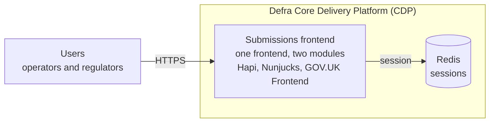
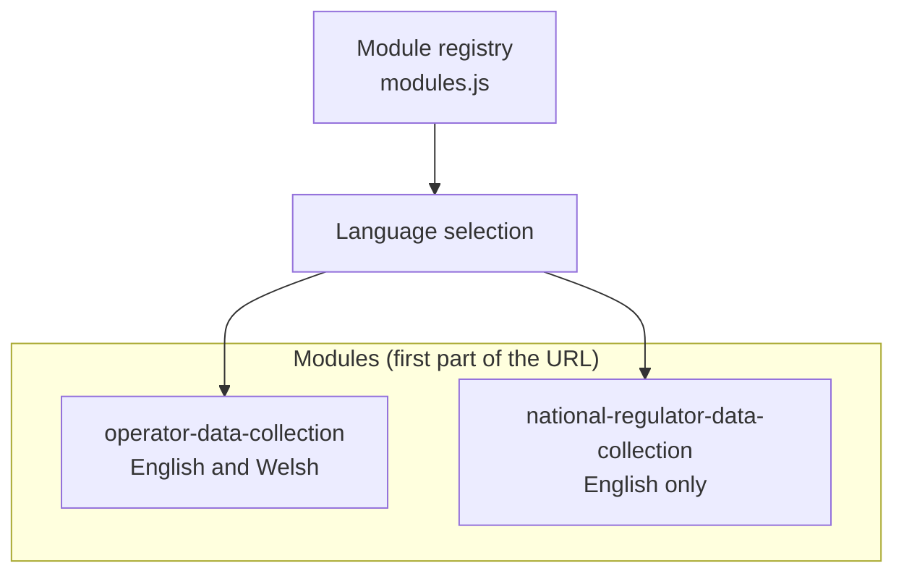
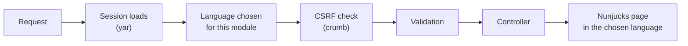
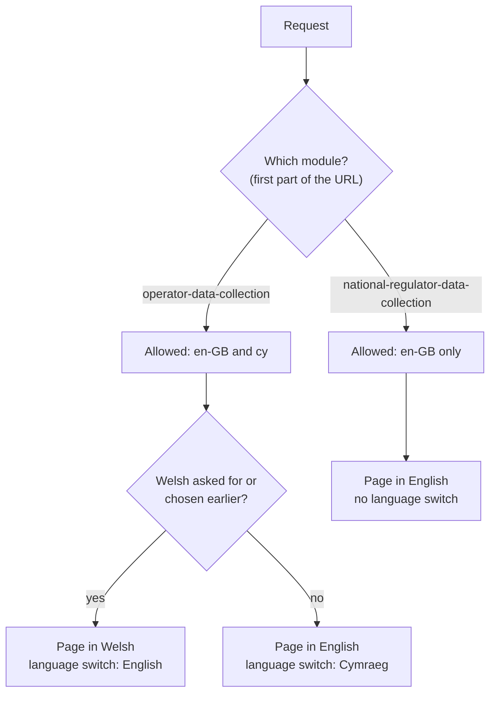

# PRTR digital service: architecture overview

Prepared for stakeholders. First written 2 November 2026. Updated 24 November 2026: the service has two modules, and the sign-in flow is deferred (still being discussed). More modules will be added later.

Services:

- `aqie-prtr-submissions-frontend`: the one web application. It serves both modules.

Diagrams in this document are written in Mermaid. They render in GitHub, in VS Code (Markdown preview with a Mermaid extension) and in most documentation tools.

---

## 1. Summary

The Pollutant Release and Transfer Register (PRTR) service lets operators and regulators work with PRTR data through a GOV.UK-styled website. It has **two modules**, and more will be added later:

| # | Module | URL prefix (proposed) | Users | Purpose | Welsh |
|---|---|---|---|---|---|
| 1 | **Operator data collection** | `/operator-data-collection` | operators | Collect pollutant and waste data from operators (built mostly with Defra forms) | **Yes** |
| 2 | **National Regulator data collection** | `/national-regulator-data-collection` | national regulators | Collect data from national regulators (built mostly with Defra forms) | No |

The URL prefixes are proposals and need confirming. The Welsh setting for module 2 is an assumption (internal users, English only) and needs confirming. The detailed scope of module 2 is still to be defined.

Key points:

- **One frontend serves both modules.**
- **Modules are separated by URL.** The first part of the URL (`/operator-data-collection/...`) identifies the module. It decides the landing page and the language rules.
- **Only the Operator data collection module is in Welsh.** The National Regulator data collection module stays in English.
- **Authentication is deferred.** The sign-in flow is still in discussion (a magic link for every user is being considered). It is not designed or built now, but `GET/POST /<module>/sign-in` stays in scope for the future (section 6).
- **Built on Defra's Core Delivery Platform (CDP)** with the standard Defra Node.js stack, GOV.UK Frontend and Redis.
- **Defra forms** (the Defra forms engine) will provide the forms for both modules.

### Current status

| Area | Status |
|---|---|
| Starter Home and About pages | **Removed** |
| Module registry and landing pages for the two modules | **Planned** |
| Authentication and sign-in routes | **Deferred**. Design not started, see section 6 |
| Data design | **To be decided later** |
| Language rules per module, Welsh text | **Planned** (see section 9) |
| Defra forms for modules 1 and 2 | **Planned** (a working reference exists in `aqie-prtr-frontend`) |
| Production hardening (secrets, proxy, monitoring) | **Planned** |

---

## 2. System overview



The **submissions frontend** serves the pages of both modules and holds the user's session.

Authentication is not shown because it is not designed yet (section 6).

---

## 3. Hosting and infrastructure (CDP)

The service runs on Defra's **Core Delivery Platform (CDP)**.

| Topic | How it is used |
|---|---|
| Packaging | Each service is a Docker container (multi-stage `Dockerfile`: development and production images) |
| Environments | `infra-dev`, `management`, `dev`, `test`, `perf-test`, `ext-test`, `prod` (the list the services are configured for) |
| Data services | Redis for sessions (Redis keys are namespaced by service name) |
| Outbound traffic | Through the platform proxy (configured by environment variables) |
| Configuration and secrets | Environment variables validated at start-up (`convict`). Secrets such as the Notify API key and cookie password come from CDP, never from the code |
| Logging and tracing | Structured JSON logs (ECS format, `pino`), request tracing header `x-cdp-request-id`, platform audit and metrics libraries (`@defra/cdp-auditing`, `@defra/cdp-metrics`) |
| Health | `GET /health` used by the platform to check the service |
| Build and delivery | GitHub Actions workflows (`check-pull-request`, `publish`, `publish-hotfix`), SonarCloud quality checks, Dependabot template |
| Local development | Docker Compose with Redis 7.2 and Floci (a local AWS emulator), so developers can run everything on a laptop |

---

## 4. Technology stack

### 4.1 Frontend (`aqie-prtr-submissions-frontend`)

| Area | Technology | Version |
|---|---|---|
| Runtime | Node.js | 24 or later |
| Web framework | Hapi (`@hapi/hapi`) | 21.4 |
| Template engine | Nunjucks with `@hapi/vision` | 3.2 |
| UI framework | GOV.UK Frontend (GOV.UK Design System) | 6.6 |
| Styling and build | Sass and Vite | Vite 8 |
| Validation | Joi | 18 |
| Authentication | Not decided. A magic link is under discussion (see section 6) | n/a |
| Session management | `@hapi/yar` (session), Redis via `@hapi/catbox-redis` and `ioredis` (in-memory cache for local development) | yar 11 |
| CSRF protection | `@hapi/crumb` | 9 |
| Security headers | `blankie` (Content Security Policy), HSTS, `@hapi/scooter` | n/a |
| Configuration | `convict` | 6.2 |
| Logging | `pino`, `hapi-pino`, ECS format | pino 10 |
| Language support (i18n) | In-house module (`helpers/i18n.js`), no third-party library; see section 9 | n/a |
| Forms (planned) | Defra forms engine (`@defra/forms-engine-plugin`) | 5.0.0-alpha.25 |
| Testing | Vitest with coverage (v8), `cheerio`, `vitest-fetch-mock` | Vitest 4 |
| Code quality | ESLint (neostandard), Prettier, Stylelint, Husky pre-commit hooks, SonarCloud | ESLint 9 |

---

## 5. Key architectural decisions

| # | Decision | Why |
|---|---|---|
| D1 | One **server-rendered frontend** shared by both modules | Follows the CDP pattern. Pages work without client-side JavaScript, as the GOV.UK service standard expects |
| D2 | **GOV.UK Frontend / Design System** for all pages | Accessible, consistent, familiar to users |
| D3 | The **module is the first URL segment** (for example `/operator-data-collection`), looked up in one **module registry** | One simple rule drives the landing page and the language. Adding a module is a registry entry |
| D4 | **Two modules for now**: Operator data collection and National Regulator data collection. More modules will be added later | Agreed scope |
| D5 | **Authentication is deferred.** The sign-in flow is not designed or built now. `GET/POST /<module>/sign-in` stays in scope for the future | The flow (a magic link for every user) is still in discussion. The URL shape is kept so modules do not need to change later |
| D6 | **Language rules per module** (English `en-GB` and Welsh `cy`) | Only the Operator data collection module needs Welsh. The others stay English |
| D7 | **Defra forms engine** for the forms in modules 1 and 2 | Defra's standard way to build accessible, multi-page forms from a definition file, with built-in Welsh support |
| D8 | Configuration from **validated environment variables**; secrets from CDP | Safe, consistent across environments |

---

## 6. Authentication (deferred)

### 6.1 Status

The sign-in flow is **not designed or built now**. It is still being discussed. The option under discussion is a **magic link**: every user receives a link by email that gives them access to the services. This flow is out of scope until the decision is made.

### 6.2 What stays in scope for the future

| Item | Detail |
|---|---|
| Sign-in routes | `GET/POST /<module>/sign-in` stays in scope for every module. The module is the first path segment, as for all other pages. Nothing is built for these routes now |
| Reserved page names | `sign-in` and `sign-out` are reserved inside every module. No form or page may use them |
| Per-module registry | The module registry (section 7) can later get an authentication setting per module, without changing the URL shape |
| Landing pages | Each module has a landing page. It is the target after sign-in once sign-in exists |

Until sign-in exists the module pages are **not protected**. This is acceptable for development only and must be closed before any real use (section 14).

### 6.3 Open questions for the sign-in decision

- How the magic link is created, how long it is valid, and whether it can be used once.
- Who sends the email (likely GOV.UK Notify, section 11) and from which service.
- Whether one link works for one module or for all of a user's modules.
- How a user is linked to their facilities.
- What the session holds after sign-in, and how long it lasts.
- Whether `GET/POST /<module>/sign-in` is still the right shape for a magic link, or whether it only becomes a landing route for the link.

---

## 7. How modules are separated

### 7.1 The module registry

```text
Frontend  src/config/modules.js       URL prefix -> languages, landing page
```

The registry is the single place that describes the modules. Only the frontend needs it for now.

```js
// frontend: src/config/modules.js (sketch)
'operator-data-collection': {
  languages: ['en-GB', 'cy'],
  startPath: '/operator-data-collection/facilities'
},
'national-regulator-data-collection': {
  languages: ['en-GB']
  // landing page to be decided
}
```

Adding a module means adding one entry to the registry. The language rules pick it up automatically. An authentication setting can be added to each entry once the sign-in decision is made (section 6).

#### Adding a new module later

1. Choose a URL prefix. It must not clash with shared paths (`cookies`, `health`, `public`) or with the reserved page names `sign-in` and `sign-out`.
2. Add the module to the frontend registry: prefix, allowed languages and landing page.
3. Add the landing page and its `content.js` (with a `cy` block only if the module supports Welsh).



### 7.2 URL structure

| URL | Purpose |
|---|---|
| `/{module}` | Module entry. For now it goes to the landing page |
| `/{module}/sign-in` | **Future scope.** `GET/POST`, not built now (section 6) |
| `/{module}/sign-out` | **Future scope.** Not built now |
| `/operator-data-collection/facilities` | Operator data collection landing page |
| `/national-regulator-data-collection/...` | National Regulator data collection pages (landing page to be decided) |
| `/cookies`, `/health` | Shared pages, outside any module |

### 7.3 Folder structure

```text
aqie-prtr-submissions-frontend/
  src/
    config/
      modules.js                      module registry (prefix, languages, landing page)
      config.js                       validated configuration (convict)
      nunjucks/                       template engine setup and page context
    server/
      server.js                       creates the Hapi server and registers plugins
      plugins/
        language-selection.js         chooses English or Welsh per module
        csrf.js, session-cache.js     CSRF and sessions
        content-security-policy.js    security headers
        router.js                     registers all routes
      routes/
        operator-data-collection/facilities/   module 1 landing page
        national-regulator-data-collection/    module 2
        cookies/  health/             shared pages
      common/
        helpers/i18n.js               language support
        templates/layouts/page.njk    shared page layout
        components/                   shared UI components
```

The future sign-in routes (section 6) will be registered per module when the flow is decided.

### 7.4 What happens to a request



When sign-in is added, a module check (signed in or redirect to `/<module>/sign-in`) is inserted after the CSRF check.

Choosing the language early means that even error pages (such as a failed CSRF check) appear in the right language.

---

## 8. Data design

To be decided later.

---

## 9. Welsh language support

### 9.1 Rules

| Module | Languages | Language switch |
|---|---|---|
| Operator data collection | English (`en-GB`) and Welsh (`cy`) | Shown |
| National Regulator data collection | English only | Hidden |

- The language code for English is **`en-GB`** (not `en`). Welsh is **`cy`**. This matches the Defra forms engine.
- The language is chosen with `?language=cy` or `?language=en-GB`, remembered in the session, and defaults to English.
- English-only modules ignore a Welsh request, show no switch and keep `<html lang="en-GB">`, including on error pages.
- A user's Welsh choice is remembered when they pass through an English-only module and come back to the Welsh one.

### 9.2 How it works



### 9.3 i18n (language support) in this project

- Language support is provided by a small **in-house i18n module** (`src/server/common/helpers/i18n.js`). It has **no third-party i18n dependency**.
- Page text lives in a `content.js` file next to each page, with an `en-GB` block and a `cy` block side by side, so both languages are edited together.
- The module scans these files at start-up. Text is looked up by key (`t('login.email.default.title')`). If a Welsh string is missing, English is shown, never an error.
- The sign-in pages share text with a `default` set and per-module overrides, so only what differs is written for each module.
- The Defra forms engine has its **own translation mechanism** for form content (see section 10). The two work side by side and use the same language codes.

### 9.4 Welsh status

Only the shared error summary title has Welsh text so far. The Operator data collection pages need Welsh text, which **must be reviewed by a Welsh translator** before real use.

---

## 10. Defra forms

The forms in the **Operator data collection** and **National Regulator data collection** modules will be built mostly with the **Defra forms engine**, Defra's standard forms framework.

| Topic | Detail |
|---|---|
| Package | `@defra/forms-engine-plugin` |
| Version | **5.0.0-alpha.25**, the latest line at the time of writing |
| Why this version | It is the line that supports Welsh. The team's finding is that earlier versions do not, so the version is pinned |
| What it gives us | Multi-page forms described by JSON definition files, GOV.UK styled pages, validation, summary and "check your answers" pages, and plug-in points for custom pages |
| Forms definitions | JSON files (schema 2, engine V2) listing pages, questions and lists |
| Welsh | A `metadata.translations.cy` block in each definition holds the Welsh titles, hints and list items, keyed by the page and question ids |
| Language hook | The application supplies a `getLanguage` function so the engine uses the same language as the rest of the site |
| Custom pages | Custom page controllers for special pages (for example dynamic radio lists and summary pages) |
| Sign-in | Deferred (section 6). Once sign-in exists, the engine's `onRequest` hook can redirect signed-out users to the module's sign-in page |
| Reference | A working example exists in `aqie-prtr-frontend` (two forms with Welsh) |

Status: **not yet added to `aqie-prtr-submissions-frontend`**. The landing pages are placeholders so the sign-in and navigation could be built first. Adding the forms is the next phase.

Points to resolve when adding forms:

- Forms are served at `/{form-slug}/...`, so a form's slug must sit under its module prefix (or be listed against the module in the registry).
- The pages `sign-in` and `sign-out` are reserved names and must not be used as form page paths.
- The engine's `getLanguage(query, yar)` hook has no access to the URL, so the effective language for the request will be saved in the session for the engine to read.

---

## 11. GOV.UK Notify (email)

| Topic | Detail |
|---|---|
| Purpose | Not used now. Sign-in is deferred (section 6). If the magic link is chosen, Notify is the likely way to email it |
| Caller | To be decided |
| Configuration | API key and template id from environment variables (`GOVUK_NOTIFY_API_KEY`, `GOVUK_NOTIFY_AUTHENTICATION_TEMPLATE_ID`). Secrets come from CDP |
| Key types | Test (no email sent), Team and guest list (real email to approved addresses, for development and test environments), Live (production) |
| Not used | The separate `aqie-notify-service` is not used. A direct call is simpler for one email type |

---

## 12. Quality and testing

| Layer | Approach |
|---|---|
| Unit and integration tests | Vitest. The frontend tests cover each module's landing page and language rules. |
| Test coverage areas | Landing page for each module, CSRF, language rules per module. Notify is replaced by a test double when it is used, so tests never send email. Sign-in tests are added with the sign-in flow |
| Static analysis | ESLint (neostandard), Stylelint for styles, Prettier for formatting |
| Pre-commit | Husky hooks run formatting, lint and tests |
| Pipeline | GitHub Actions on pull requests and publishing |
| Quality gate | SonarCloud |
| Accessibility | GOV.UK Design System components, error summaries, correct `lang` attributes |

---

## 13. Roadmap

| Phase | Content | Status |
|---|---|---|
| 0 | Remove the starter Home and About pages | Done |
| 1 | Module registry and landing pages for the two modules | Planned |
| 2 | Language rules per module, Welsh text for the Operator data collection module | Planned |
| 3 | Defra forms for Operator data collection and National Regulator data collection | Planned |
| 4 | Authentication: the sign-in flow and `GET/POST /<module>/sign-in`. Starts when the magic link decision is made | Deferred |
| 5 | Hardening: secrets, proxy, accessibility review, monitoring (and rate limiting once sign-in exists) | Planned |

## 14. Risks and open decisions

| Item | Notes |
|---|---|
| Authentication not decided | The sign-in flow (magic link for every user) is still in discussion. See the open questions in section 6.3 |
| Pages are unprotected until sign-in exists | Acceptable for development only. Must be closed before real use |
| Scope of module 2 | National Regulator data collection is named but not yet defined: users, pages, data |
| URL prefixes | Proposed in section 1. Need confirming |
| Welsh for module 2 | Assumed English only. Needs confirming |
| Linking users to facilities | How a user is linked to facilities is not decided. Depends on the authentication decision |
| Data design | To be decided later |
| Welsh text | Needs translator sign-off. Every page in the Welsh module needs Welsh text before release |
| Defra forms is an alpha release | Pin the version, review changes before upgrading, keep a reference implementation |
| Public facing pages | The bare service URL `/` has no page yet |

## Glossary

| Term | Meaning |
|---|---|
| CDP | Core Delivery Platform, Defra's hosting platform |
| Submissions frontend | `aqie-prtr-submissions-frontend`. The one web application that serves both modules |
| PRTR | Pollutant Release and Transfer Register |
| Magic link | A link sent by email that gives access to the service. Under discussion for authentication, not designed yet |
| CSRF | Cross-site request forgery, an attack the form tokens prevent |
| i18n | Internationalisation, supporting more than one language |
| `en-GB` / `cy` | Language codes for British English and Welsh |