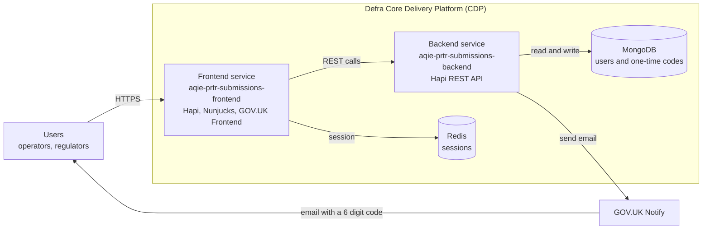
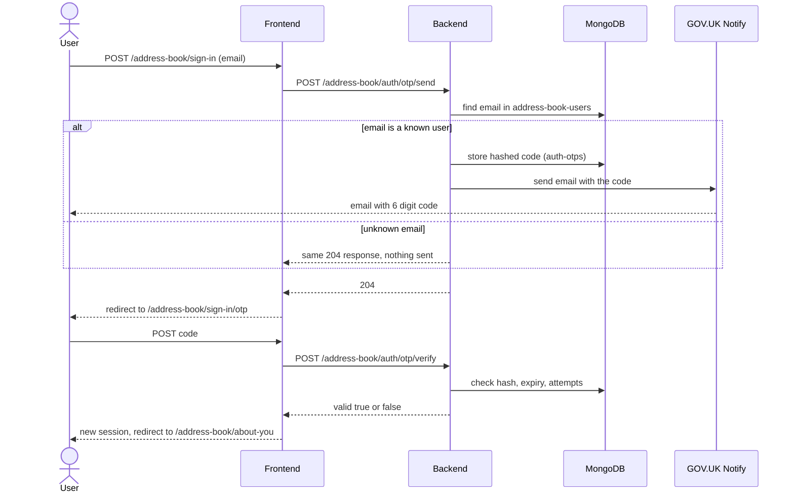
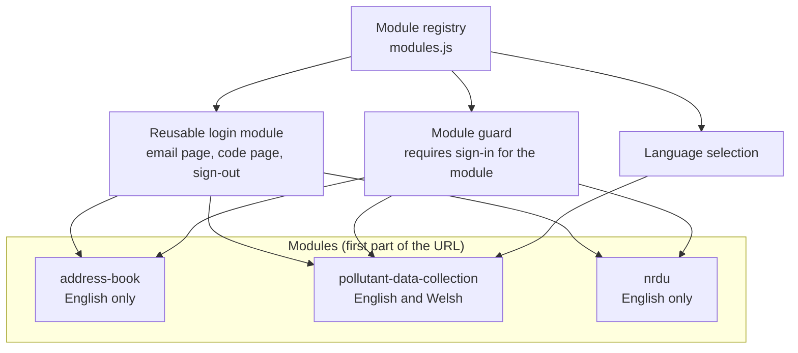
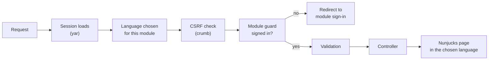
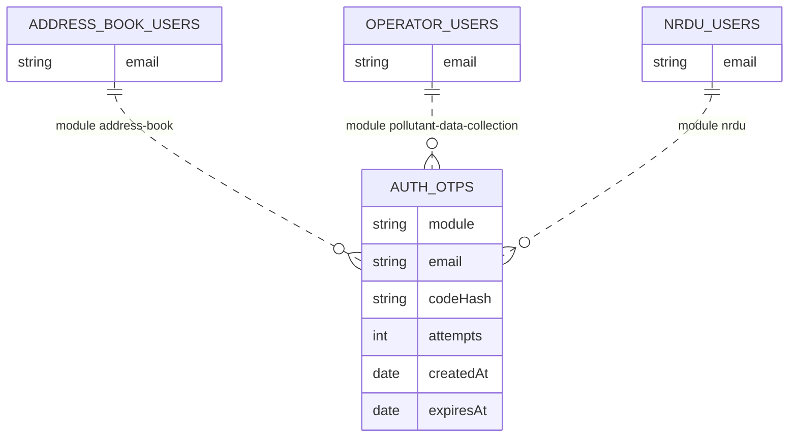
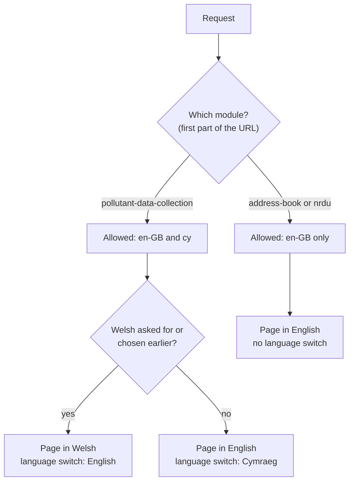

# PRTR digital service: architecture overview

Prepared for stakeholders. Date: 2 November 2026.

Repositories: `aqie-prtr-submissions-frontend` (web application) and `aqie-prtr-submissions-backend` (API and database).

Diagrams in this document are written in Mermaid. They render in GitHub, in VS Code (Markdown preview with a Mermaid extension) and in most documentation tools.

---

## 1. Summary

The Pollutant Release and Transfer Register (PRTR) service lets three groups of users report data through a GOV.UK-styled website:

| Module | URL prefix | Users | Purpose | Welsh |
|---|---|---|---|---|
| **Authentication** | inside each module | all users | One reusable sign-in (email, then a one-time code) used by every module | Follows the module it sits in |
| **PRTR address book** | `/address-book` | operators / facilities | Collect contact details of the facilities and operators who will report | No |
| **PRTR data collection** | `/pollutant-data-collection` | operators | Collect pollutant and waste data (built mostly with Defra forms) | **Yes** |
| **National regulator data upload (NRDU)** | `/nrdu` | national regulators | Upload pollutant release data as files | No |

Key points:

- **One login, reused three times.** The sign-in pages are built once and placed inside each module. Each module checks users against its own collection.
- **Modules are separated by URL.** The first part of the URL (`/address-book/...`) identifies the module. It decides the sign-in text, the user collection, the landing page and the language rules.
- **Only the data collection module is in Welsh.** The other two are internal or admin facing and stay in English.
- **Built on Defra's Core Delivery Platform (CDP)** with the standard Defra Node.js stack, GOV.UK Frontend, MongoDB, Redis and GOV.UK Notify.
- **Defra forms** (the Defra forms engine) will provide the data collection forms for modules 2 and 3.

### Current status

| Area | Status |
|---|---|
| Authentication module (email, code, sign-out) | **Built and tested** for all three modules |
| Per-module users, session and landing pages | **Built** (landing pages are blank placeholders) |
| Welsh text for the sign-in pages and the data collection landing page | **Built** (written for development, needs translator review) |
| Language rules per module | **Built and tested** |
| Defra forms for modules 2 and 3 | **Planned** (a working reference exists in `aqie-prtr-frontend`) |
| NRDU file upload | **Planned** |
| Production hardening (rate limiting, secrets, proxy for Notify) | **Planned** |

---

## 2. System overview



Two services, one database:

- The **frontend** serves pages, holds the user's session and talks only to the backend.
- The **backend** owns the users, the one-time codes and the email sending. The browser never talks to it, and never sees a code.

---

## 3. Hosting and infrastructure (CDP)

The service runs on Defra's **Core Delivery Platform (CDP)**.

| Topic | How it is used |
|---|---|
| Packaging | Each service is a Docker container (multi-stage `Dockerfile`: development and production images) |
| Environments | `infra-dev`, `management`, `dev`, `test`, `perf-test`, `ext-test`, `prod` (the list the services are configured for) |
| Data services | MongoDB for data, Redis for sessions (Redis keys are namespaced by service name) |
| Outbound traffic | Through the platform proxy (configured by environment variables), including calls to GOV.UK Notify |
| Configuration and secrets | Environment variables validated at start-up (`convict`). Secrets such as the Notify API key and cookie password come from CDP, never from the code |
| Logging and tracing | Structured JSON logs (ECS format, `pino`), request tracing header `x-cdp-request-id`, platform audit and metrics libraries (`@defra/cdp-auditing`, `@defra/cdp-metrics`) |
| Health | `GET /health` used by the platform to check the service |
| Build and delivery | GitHub Actions workflows (`check-pull-request`, `publish`, `publish-hotfix`), SonarCloud quality checks, Dependabot template |
| Local development | Docker Compose with MongoDB 7.0, Redis 7.2 and Floci (a local AWS emulator), so developers can run everything on a laptop |

---

## 4. Technology stack

### 4.1 Frontend (`aqie-prtr-submissions-frontend`)

| Area | Technology | Version |
|---|---|---|
| Runtime | Node.js | 24 or later |
| Web framework | Hapi (`@hapi/hapi`) | 21.4 |
| Template engine | Nunjucks with `@hapi/vision` | 3.2 |
| UI framework | GOV.UK Frontend (GOV.UK Design System) | 6.6 |
| Styling and build | Sass and Vite | Vite 8 |
| Validation | Joi | 18 |
| Authentication | Email one-time code, checked by the backend (see section 6) | n/a |
| Session management | `@hapi/yar` (session), Redis via `@hapi/catbox-redis` and `ioredis` (in-memory cache for local development) | yar 11 |
| CSRF protection | `@hapi/crumb` | 9 |
| Security headers | `blankie` (Content Security Policy), HSTS, `@hapi/scooter` | n/a |
| Configuration | `convict` | 6.2 |
| Logging | `pino`, `hapi-pino`, ECS format | pino 10 |
| Language support (i18n) | In-house module (`helpers/i18n.js`), no third-party library; see section 9 | n/a |
| Forms (planned) | Defra forms engine (`@defra/forms-engine-plugin`) | 5.0.0-alpha.25 |
| Testing | Vitest with coverage (v8), `cheerio`, `vitest-fetch-mock` | Vitest 4 |
| Code quality | ESLint (neostandard), Prettier, Stylelint, Husky pre-commit hooks, SonarCloud | ESLint 9 |

### 4.2 Backend (`aqie-prtr-submissions-backend`)

| Area | Technology | Version |
|---|---|---|
| Runtime | Node.js | 24 or later |
| Web framework | Hapi (`@hapi/hapi`) with `@hapi/boom` for errors | 21.4 |
| Database | MongoDB (official `mongodb` driver) | driver 7.7, server 7.0 |
| Validation | Joi | 18 |
| Email | GOV.UK Notify (`notifications-node-client`) | 8.2 |
| Authentication | One-time code, hashed with HMAC-SHA256 (Node `crypto`) | n/a |
| Locks | `mongo-locks` | 3.2 |
| Configuration | `convict` | 6.2 |
| Logging | `pino`, `hapi-pino` | pino 10 |
| Testing | Vitest with coverage, `vitest-mongodb` (in-memory MongoDB), `vitest-fetch-mock` | Vitest 4 |
| Code quality | ESLint (neostandard), Prettier, Husky, SonarCloud | n/a |

Test coverage today: backend 28 automated tests, frontend 145 automated tests.

---

## 5. Key architectural decisions

| # | Decision | Why |
|---|---|---|
| D1 | Two services: a **server-rendered frontend** and a separate **REST backend** | Follows the CDP pattern. Keeps data, secrets and email sending away from the browser. Pages work without client-side JavaScript, as the GOV.UK service standard expects |
| D2 | **GOV.UK Frontend / Design System** for all pages | Accessible, consistent, familiar to users |
| D3 | The **module is the first URL segment** (`/address-book`, `/pollutant-data-collection`, `/nrdu`), looked up in one **module registry** | One simple rule drives sign-in text, user collection, landing page and language. Adding a module is a registry entry |
| D4 | **One reusable login module**, registered once per module | No duplicate sign-in code. Each module only changes the text and the user collection |
| D5 | **Separate sign-in per module** | Users must sign in to each module. Public and admin users never share a login |
| D6 | **A user collection per module** in MongoDB | A user is only recognised in the module they belong to |
| D7 | **The backend owns codes, users and email.** The frontend only stores "signed in to module X" | Codes never reach the browser. One place to enforce security rules |
| D8 | **GOV.UK Notify called directly from the backend** with one shared email template | Simple and secure. No extra service needed for this flow |
| D9 | **Language rules per module** (English `en-GB` and Welsh `cy`) | Only the public facing module needs Welsh. Admin modules stay English |
| D10 | **Defra forms engine** for data collection forms (modules 2 and 3) | Defra's standard way to build accessible, multi-page forms from a definition file, with built-in Welsh support |
| D11 | **No account enumeration:** an unknown email gets the same answer as a known one | Prevents anyone from discovering which emails have accounts |
| D12 | Configuration from **validated environment variables**; secrets from CDP | Safe, consistent across environments |

---

## 6. The reusable authentication module

### 6.1 User journey

1. The user opens a module URL, for example `/address-book`.
2. If not signed in, they are redirected to that module's sign-in page: `/address-book/sign-in`.
3. They enter their email address. If the address belongs to a user of this module, a **6-digit code** is emailed to them using GOV.UK Notify.
4. They enter the code on `/address-book/sign-in/otp`.
5. On success they land on the module's first page and stay signed in for that module (4 hours).
6. A **Sign out** button in the header ends the sign-in for that module only.

| Module | Landing page after sign-in |
|---|---|
| PRTR address book | `/address-book/about-you` |
| PRTR data collection | `/pollutant-data-collection/facilities` |
| NRDU | `/nrdu/upload-pollutant-release-data` |

The bare module URL is also handled: signed out it goes to sign-in, signed in it goes to the landing page.

### 6.2 Sign-in sequence



### 6.3 Security measures

| Measure | Detail |
|---|---|
| Code generation | Cryptographically random 6-digit code |
| Code storage | Only an HMAC-SHA256 hash is stored (the module name is part of the hash). The code is never stored or logged in clear text |
| Expiry and single use | Valid for 10 minutes. Deleted as soon as it is used |
| Attempt limit | 5 wrong attempts lock the code (counted atomically, so parallel guesses cannot get around it) |
| Resend cooldown | 60 seconds between emails to the same address |
| No account enumeration | Same response for known and unknown emails |
| Module isolation | A code for one module cannot be used in another |
| New session on sign-in | A fresh session id is issued after sign-in (prevents session fixation) |
| CSRF protection | All form posts, including sign-out, need a token (`@hapi/crumb`) |
| Transport and headers | HTTPS, secure cookies in production, HSTS, Content Security Policy |

### 6.4 Session management

- The session is created with `@hapi/yar` and stored with a cookie (4 hour lifetime). Redis is used for server-side caching in CDP environments, and an in-memory cache locally.
- Sign-in state is kept **per module**: `{ "address-book": { email, authenticated }, "nrdu": { ... } }`. Signing in to one module never signs the user in to another, and a user can be signed in to several at once.
- Sign-out removes only the current module's entry.

---

## 7. How modules are separated

### 7.1 The module registry

```text
Frontend  src/config/modules.js      URL prefix -> languages, landing page
Backend   src/common/auth-modules.js  module     -> user collection
```

Adding a module means adding one entry to each. The sign-in pages, routes, guard and language rules pick it up automatically.



### 7.2 URL structure

| URL | Purpose |
|---|---|
| `/{module}` | Entry: goes to sign-in or to the landing page |
| `/{module}/sign-in` | Email page |
| `/{module}/sign-in/otp` | Code page |
| `/{module}/sign-out` | Sign out (POST) |
| `/address-book/about-you` | Address book landing page |
| `/pollutant-data-collection/facilities` | Data collection landing page |
| `/nrdu/upload-pollutant-release-data` | NRDU landing page |
| `/cookies`, `/health` | Shared pages, outside any module |

### 7.3 Folder structure

```text
aqie-prtr-submissions-frontend/
  src/
    config/
      modules.js                      module registry (prefix, languages, landing page)
      config.js                       validated configuration (convict)
      nunjucks/                       template engine setup and page context
    server/
      server.js                       creates the Hapi server and registers plugins
      plugins/
        language-selection.js         chooses English or Welsh per module
        module-auth.js                guard: redirects to sign-in when not signed in
        csrf.js, session-cache.js     CSRF and sessions
        content-security-policy.js    security headers
        router.js                     registers all routes
      routes/
        login/                        THE REUSABLE LOGIN MODULE
          index.js                    registers the sign-in routes for every module
          email/  otp/                controllers, templates and text of the two pages
          auth-service.js             calls the backend
          auth-session.js             per-module sign-in state
          sign-out-controller.js      sign-out
          entry-controller.js         bare module URL
        address-book/about-you/       module 2 landing page
        pollutant-data-collection/facilities/   module 3 landing page
        nrdu/upload-pollutant-release-data/     module 4 landing page
        cookies/  health/             shared pages
      common/
        helpers/i18n.js               language support
        templates/layouts/page.njk    shared page layout
        components/                   shared UI components

aqie-prtr-submissions-backend/
  src/
    common/auth-modules.js            module -> user collection
    routes/auth.js                    POST /{module}/auth/otp/send and /verify
    services/
      otp-service.js                  codes: create, hash, check, expire
      notify-client.js                GOV.UK Notify
    plugins/mongodb.js                database connection and indexes
```

### 7.4 What happens to a request



Choosing the language early means that even error pages (such as a failed CSRF check) appear in the right language.

---

## 8. Data design (MongoDB)



| Collection | Purpose | Key fields | Indexes |
|---|---|---|---|
| `address-book-users` | Users allowed into the address book module | `email` | to be defined |
| `operator-users` | Users allowed into the data collection module | `email` | to be defined |
| `nrdu-users` | Users allowed into the NRDU module | `email` | to be defined |
| `auth-otps` | Short-lived one-time codes, one live code per module and email | `module`, `email`, `codeHash`, `attempts`, `createdAt`, `expiresAt` | unique on `module` + `email`; automatic deletion at `expiresAt` |

Notes:

- The three user collection names are **placeholders**. The final names and fields will be decided later and are changed in one place (the backend registry).
- `auth-otps` holds no personal data beyond the email, and entries remove themselves after they expire.
- Data collection records (pollutant data, facilities, address book entries) will be designed with the Defra forms work.

---

## 9. Welsh language support

### 9.1 Rules

| Module | Languages | Language switch |
|---|---|---|
| PRTR data collection | English (`en-GB`) and Welsh (`cy`) | Shown |
| PRTR address book | English only | Hidden |
| NRDU | English only | Hidden |

- The language code for English is **`en-GB`** (not `en`). Welsh is **`cy`**. This matches the Defra forms engine.
- The language is chosen with `?language=cy` or `?language=en-GB`, remembered in the session, and defaults to English.
- English-only modules ignore a Welsh request, show no switch and keep `<html lang="en-GB">`, including on error pages.
- A user's Welsh choice is remembered when they pass through an English-only module and come back to the Welsh one.

### 9.2 How it works



### 9.3 i18n (language support) in this project

- Language support is provided by a small **in-house i18n module** (`src/server/common/helpers/i18n.js`). It has **no third-party i18n dependency**.
- Page text lives in a `content.js` file next to each page, with an `en-GB` block and a `cy` block side by side, so both languages are edited together.
- The module scans these files at start-up. Text is looked up by key (`t('login.email.default.title')`). If a Welsh string is missing, English is shown, never an error.
- The sign-in pages share text with a `default` set and per-module overrides, so only what differs is written for each module.
- The Defra forms engine has its **own translation mechanism** for form content (see section 10). The two work side by side and use the same language codes.

### 9.4 Welsh status

Welsh text exists for the sign-in pages, the data collection landing page, the sign-out button and the error summary title. It was written for development and **must be reviewed by a Welsh translator** before real use.

---

## 10. Defra forms

The data collection modules (address book and pollutant data) will be built mostly with the **Defra forms engine**, Defra's standard forms framework.

| Topic | Detail |
|---|---|
| Package | `@defra/forms-engine-plugin` |
| Version | **5.0.0-alpha.25**, the latest line at the time of writing |
| Why this version | It is the line that supports Welsh. The team's finding is that earlier versions do not, so the version is pinned |
| What it gives us | Multi-page forms described by JSON definition files, GOV.UK styled pages, validation, summary and "check your answers" pages, and plug-in points for custom pages |
| Forms definitions | JSON files (schema 2, engine V2) listing pages, questions and lists |
| Welsh | A `metadata.translations.cy` block in each definition holds the Welsh titles, hints and list items, keyed by the page and question ids |
| Language hook | The application supplies a `getLanguage` function so the engine uses the same language as the rest of the site |
| Custom pages | Custom page controllers for special pages (for example dynamic radio lists and summary pages) |
| Sign-in | The engine's `onRequest` hook redirects signed-out users to the module's sign-in page |
| Reference | A working example exists in `aqie-prtr-frontend` (two forms with Welsh) |

Status: **not yet added to `aqie-prtr-submissions-frontend`**. The landing pages are placeholders so the sign-in and navigation could be built first. Adding the forms is the next phase.

Points to resolve when adding forms:

- Forms are served at `/{form-slug}/...`, so a form's slug must sit under its module prefix (or be listed against the module in the registry).
- The pages `sign-in` and `sign-out` are reserved names and must not be used as form page paths.
- The engine's `getLanguage(query, yar)` hook has no access to the URL, so the effective language for the request will be saved in the session for the engine to read.

---

## 11. GOV.UK Notify (email)

| Topic | Detail |
|---|---|
| Purpose | Sends the one-time code by email |
| Caller | The backend, directly, using the official `notifications-node-client` |
| Template | One shared email template for all modules. The code is passed in a `((code))` placeholder |
| Configuration | API key and template id from environment variables (`GOVUK_NOTIFY_API_KEY`, `GOVUK_NOTIFY_AUTHENTICATION_TEMPLATE_ID`). Secrets come from CDP |
| Key types | Test (no email sent), Team and guest list (real email to approved addresses, for development and test environments), Live (production) |
| Resilience | If Notify fails, the stored code is removed and the user sees "we could not send a passcode" |
| Not used | The separate `aqie-notify-service` is not used for this flow. A direct call is simpler for one email type |

---

## 12. Quality and testing

| Layer | Approach |
|---|---|
| Unit and integration tests | Vitest. The frontend tests drive the whole sign-in journey for each module, including errors. The backend tests use an in-memory MongoDB |
| Test coverage areas | Sign-in, wrong and expired codes, attempt limits, resend cooldown, module isolation, sign-out, CSRF, language rules per module, Welsh pages |
| Static analysis | ESLint (neostandard), Stylelint for styles, Prettier for formatting |
| Pre-commit | Husky hooks run formatting, lint and tests |
| Pipeline | GitHub Actions on pull requests and publishing |
| Quality gate | SonarCloud |
| Accessibility | GOV.UK Design System components, error summaries, correct `lang` attributes |

---

## 13. Roadmap

| Phase | Content | Status |
|---|---|---|
| 1 | Module registry and backend sign-in API per module | Done |
| 2 | Reusable login module, per-module sessions, landing pages, sign-out | Done (a return-to-page feature is not built) |
| 3 | Language rules per module, Welsh text for the Welsh module | Done (translator review pending) |
| 4 | Defra forms for address book and data collection, NRDU upload | Planned |
| 5 | Hardening: rate limiting, secrets, proxy for Notify, accessibility review, monitoring | Planned |

## 14. Risks and open decisions

| Item | Notes |
|---|---|
| Final user collection names and fields | Placeholders in place, changed in one place |
| Welsh text | Needs translator sign-off. Every page in the Welsh module needs Welsh text before release |
| Defra forms is an alpha release | Pin the version, review changes before upgrading, keep a reference implementation |
| Sessions | The sign-in state currently lives inside the encrypted cookie for small sessions. For admin modules, storing sessions only on the server would allow them to be cancelled early |
| Public facing pages | The bare service URL `/` has no page yet |
| Notify delivery | Production needs a Live key, the platform proxy and monitoring of failed sends |

## Glossary

| Term | Meaning |
|---|---|
| CDP | Core Delivery Platform, Defra's hosting platform |
| PRTR | Pollutant Release and Transfer Register |
| NRDU | National regulator data upload |
| OTP | One-time passcode |
| CSRF | Cross-site request forgery, an attack the form tokens prevent |
| i18n | Internationalisation, supporting more than one language |
| `en-GB` / `cy` | Language codes for British English and Welsh |
